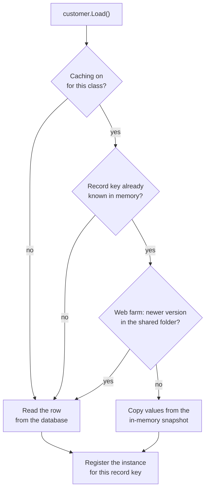

# Local caching

Silvtek.ORMEngine kept track of every record loaded in the application. When
code loaded a record that was already in memory, the engine copied the values
from memory instead of querying the database.

```xml
<global>
  <cache enabled="true" />
</global>
```

## How a load used the cache



- Each record was identified by its type and primary key.
- For each record, a **reference manager** held a snapshot of the last known
  values and a **weak reference** to every instance of that record. Weak
  references meant the cache never kept objects alive: a timer (every minute)
  removed records whose instances had all been garbage-collected.
- `Load()` used the cache; `Refresh()` always read the database.
- The same structure powered [change broadcasting](change-broadcasting.md).

## Turning it off

| Scope | How |
|---|---|
| Whole application | `<cache enabled="false"/>` or `ORMConfigurator.GlobalCacheEnabled = false` |
| One class | `[Table("Customers", "Sales", true)]` (`noCaching`) |
| Classes with binary members | Never cached, to keep large values out of memory |
| Everything cached | `ORM.ClearCaches()` |

## Query cache

Query results were cached separately, keyed by the generated SQL:

```csharp
Query query = new Query(typeof(Customer));
query.AddCriteria(where);

query.Execute();                                    // cached for <query cache-limit-ms>
query.Execute(TimeSpan.FromMinutes(5), true);       // 5 minutes, sliding
query.Execute(DateTime.Today.AddDays(1));           // until midnight
query.Execute(true);                                // real time, skip the cache

bool fromCache = query.IsResultsSetFromCache;
```

`QueryBase.ClearCache()` emptied the query cache.
