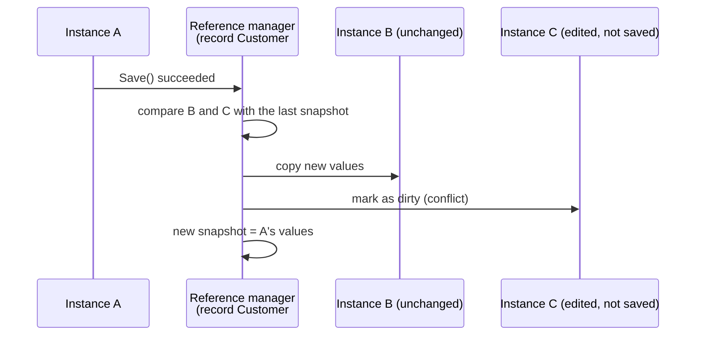

# Change broadcasting

In a typical application of the time, several screens or requests held their
own copy of the same record. When one of them saved, the others kept showing
old values until they reloaded.

Silvtek.ORMEngine solved this in memory: **when one instance of a record was
saved, every other instance of that record in the application received the new
values.** When one was removed, the others were marked as removed.

```xml
<global>
  <broadcast-changes enabled="true" />
</global>
```

## Example

```csharp
Customer onScreenA = new Customer(42);
onScreenA.Load();

Customer onScreenB = new Customer(42);
onScreenB.Load();                     // from the cache, same record

onScreenA.Email = "new@example.com";
onScreenA.Save();

Console.WriteLine(onScreenB.Email);   // "new@example.com" - no reload needed

onScreenA.Remove();
Console.WriteLine(onScreenB.ObjectInfo.BindingStatus);   // Removed
```

## How it worked



- Every loaded instance registered with the record's reference manager (see
  [Local caching](caching.md)), held through a weak reference.
- After a successful save, the manager compared each other instance with the
  previous snapshot:
    - **unchanged** instances received the new values;
    - instances **edited but not saved** were left alone and marked dirty, so
      their own save could detect the conflict instead of losing either change.
- After a remove, every other instance was marked `Removed`.

`customer.ObjectInfo.Isolated()` kept an instance from being registered, so it
neither received nor sent broadcasts (its `Load()` could still copy from the
cache).

## Across servers

In a web farm, each server had its own memory. With a shared folder configured,
the engine also wrote a small **record version file** per changed record:

```xml
<global>
  <shared path="\\fileserver\orm-versions" />
</global>
```

Before serving a record from memory, a server compared its version with the
file. A newer version made it reload the record and broadcast the new values to
its own instances; a deleted record was removed from memory. Version files
older than a day were cleaned up.
