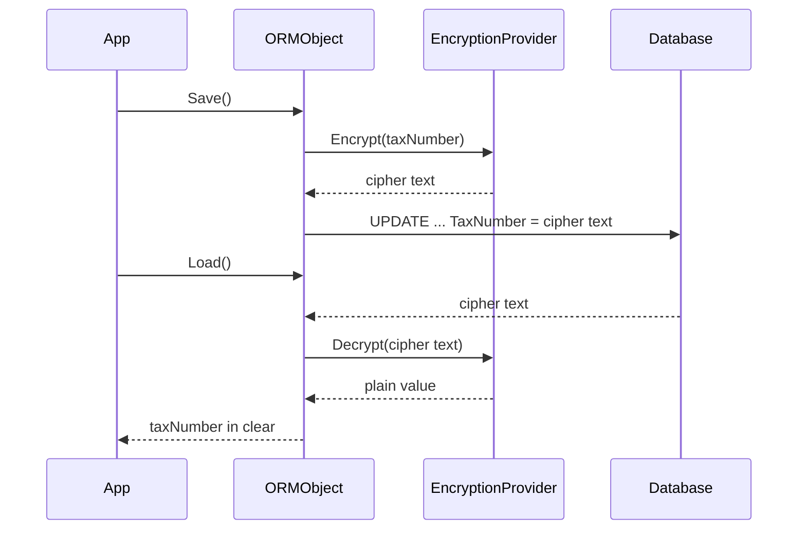

# Encryption

One attribute stored a member encrypted in the database and decrypted it on
load. Application code only ever saw the plain value.

## Encrypting a member

```csharp
[Table("Customers", "Sales")]
public class Customer : ORMObject
{
    // ...

    [Column("TaxNumber", DataType.String, 400)]
    [Encrypt("[password]", "[salt]")]
    private string taxNumber;

    [Column("SignedContract", DataType.Binary)]
    [Encrypt("[password]", "[salt]")]
    private byte[] signedContract;
}
```

- **Text members** (`DataType.String`) were stored as Base64 text of the
  encrypted bytes - size the column for that.
- **Binary members** (`byte[]`, `Stream`) were stored as encrypted bytes.
- The engine copies the attribute's password and salt into the provider's
  `Password` and `Salt` properties.

## The default provider

`DefaultEncryptionProvider` used Rijndael (AES family) with a 128-bit key
derived from the password and salt. Its initialization vector is a built-in
constant: the default provider was a starting point, and each application was
expected to supply its own provider.

## Writing your own provider

```csharp
using System.IO;
using Silvtek.ORMEngine.Encryption;

public class CustomerDataEncryption : EncryptionProvider
{
    public override string Encrypt(string value)
    {
        // Password and Salt are set from the attribute.
        return MyCrypto.EncryptToBase64(value, Password, Salt);
    }

    public override string Decrypt(string value)
    {
        return MyCrypto.DecryptFromBase64(value, Password, Salt);
    }

    public override void EncryptStream(Stream inputStream, Stream encryptedStream)
    {
        MyCrypto.EncryptStream(inputStream, encryptedStream, Password, Salt);
    }

    public override void DecryptStream(Stream encryptedStream, Stream decryptedStream)
    {
        MyCrypto.DecryptStream(encryptedStream, decryptedStream, Password, Salt);
    }
}
```

(`MyCrypto` stands for your own cryptography code.)

## Plugging it in

```csharp
// Provider only: Password and Salt are set to null, so the provider
// must get its key material itself (configuration, key store ...).
// See Known issues.
[Column("TaxNumber", DataType.String, 400)]
[Encrypt(typeof(CustomerDataEncryption))]
private string taxNumber;

// Provider with password and salt.
[Column("TaxNumber", DataType.String, 400)]
[Encrypt(typeof(CustomerDataEncryption), "[password]", "[salt]")]
private string taxNumber;
```

In the [XML mapping](data-objects.md#mapping-with-an-xml-file) design
(unfinished in 1.7), the member's `<map>` element named the provider instead:

```xml
<map member-name="taxNumber" column-name="TaxNumber" datatype="String"
     is-key="False" accepts-null="False">
  <encryptionProvider class="MyCompany.Sales.CustomerDataEncryption"
                      assembly="MyCompany.Sales" password="[password]" salt="[salt]" />
</map>
```



Encrypted members cannot be searched by value in SQL; a query on them
compares cipher text.
