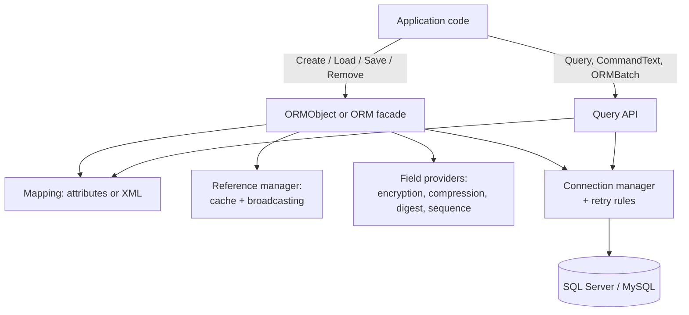

# Silvtek.ORMEngine

!!! note "Archived project - for reference only"
    Silvtek.ORMEngine is no longer maintained. Its use ended many years ago.
    This site documents how it worked, as a record of past work.

Silvtek.ORMEngine is an object-relational mapper (ORM) for .NET, started in
**2002** and developed until **2014** (version 1.7). Applications described
their classes with attributes, and the engine created the SQL to create, load,
save and remove them.

Some of its features were unusual for the time:

| Feature | In short |
|---|---|
| [Encryption](encryption.md) | One attribute stored a field encrypted, with a replaceable provider |
| [Compression](compression.md) | One attribute stored a large field compressed (GZip by default) |
| [Local caching](caching.md) | Loading a record that was already in memory did not hit the database |
| [Change broadcasting](change-broadcasting.md) | Saving one copy of a record updated every other copy in memory |
| [Record digest](record-digest.md) | A hash per row detected changes made outside the application |
| [SQL retry](sql-retry.md) | Operations retried automatically after configured SQL errors |
| [Free SQL with objects](object-sql.md) | SQL text that named classes and members, returning objects |

## How it fits together

## About the examples

There is no sample application. The examples on this site use a neutral
`Customer` / `Order` domain and were written by reading the source code: every
class, method, attribute and configuration element shown exists in version
1.7. They were **not compiled** for this site - the code targets .NET Framework
3.5 and the original build tools.

## Requirements of the time

- .NET Framework 3.5 (earlier versions also built for .NET 1.1 and 2.0)
- SQL Server, or MySQL through `Silvtek.ORMEngine.MySql`
