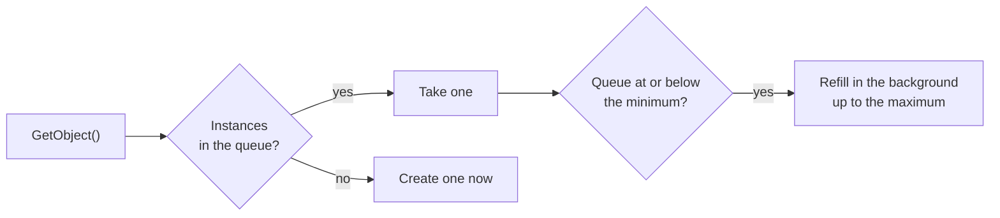

# Object pooling

The engine created many short-lived helper objects for each database
operation. To avoid paying for their creation on every call, it kept **pools of
ready-made instances**.



- Each pooled type had a minimum and a maximum number of instances.
- Instances were created ahead of time on a background thread.
- When the queue ran low, it refilled itself asynchronously; when it was empty,
  the caller got a new instance immediately, so a pool never blocked.

The engine's own connection wrapper used it:

```csharp
private static readonly Pool<Connection> connectionPool = new Pool<Connection>(45, 2500);

Connection cnn = connectionPool.GetObject();
```

`Pool<T>` was public (on .NET 2.0 and later builds), so applications could pool
their own types the same way:

```csharp
Pool<OrderCalculator> calculators = new Pool<OrderCalculator>(5, 50);
OrderCalculator calc = calculators.GetObject();
```

This is a pool of pre-created .NET objects, not a database connection pool -
ADO.NET's own connection pooling still handled the physical connections.
