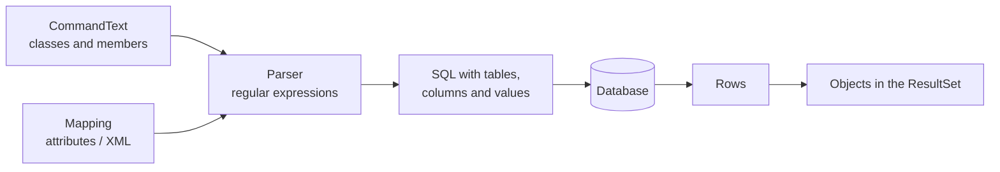

# Free SQL with objects

When the [Query API](querying.md) was too verbose, a query could be written as
SQL text that names **classes and members instead of tables and columns**. The
engine translated the text to real SQL with the mapping, ran it, and returned
objects - in 2002 terms, a small object query language.

## Syntax

| In the text | Means |
|---|---|
| `{Customer}` | The table of the class `Customer` (the class name, without namespace) |
| `{Customer} as c` | The same, with an alias |
| `select {Customer}, {Order} from ...` | Select every mapped column of those classes |
| `{Customer:name}` or `{c:name}` | The column of a mapped member |
| `@name` | A parameter |

## Example

```csharp
CommandText text = new CommandText(typeof(Customer),
    "select {Customer} from {Customer} as c " +
    "inner join {Order} as o on {o:customerId} = {c:id} " +
    "where {o:total} > @minTotal and {c:status} = @status " +
    "order by {c:name}");

text.RegisterType(typeof(Order));                         // every class the text names
text.SetParameterValue("@minTotal", typeof(Order), "total", 1000m);
text.SetParameterValue("@status", (int)CustomerStatus.Active);

Query query = new Query(typeof(Customer));
query.SetCommandText(text);
query.Execute();

foreach (Customer c in query.ResultSet.GetObjects(typeof(Customer)))
{
    Console.WriteLine(c.Name);
}
```

The engine turned it into plain SQL for the connection's database, with the
parameter values written in - roughly:

```sql
select c.CustomerID, c.Name, c.Email, c.Status
from Customers c
inner join Orders o on o.CustomerID = c.CustomerID
where o.Total > 1000 and c.Status = 1
order by c.Name
```

## Parameters

`SetParameterValue` had overloads for `string`, `int`, `DateTime` and `bool`,
and two that took the value's format from a mapped member:
`SetParameterValue(parameter, type, member, value)` and
`SetParameterValue(parameter, sourceObject, member)` (the value is read from an
object). The engine did not send them as ADO.NET parameters: it formatted
each value with the connection's [formatter](providers.md) - quoting and
escaping strings, writing dates in the database's literal format - and put
the result into the SQL text. The connection's `prepared-statement` setting does
not change this - see [Known issues](known-issues.md#object-sql-never-uses-database-parameters).

## How it worked



Because the text named members rather than columns, renaming a column only
changed the mapping, not the queries.
