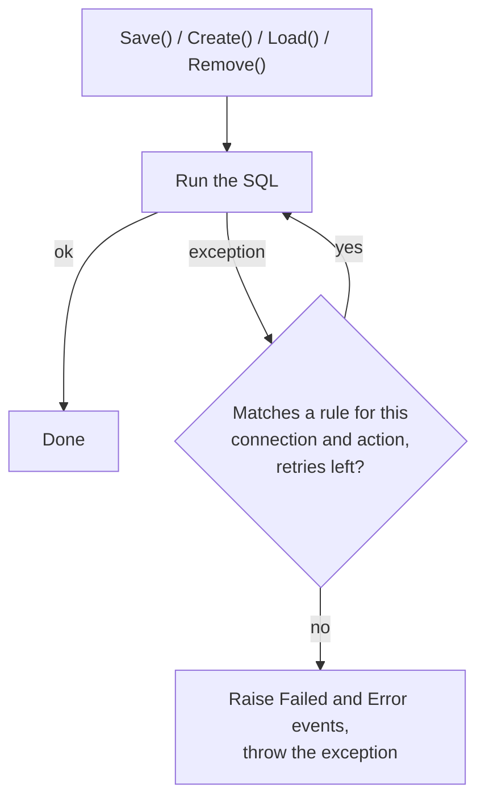

# Retry after a SQL error

Some database errors are temporary: a deadlock victim, a timeout under load.
Instead of failing, an operation could retry automatically when the error
matched a rule configured for the connection.

```xml
<connection name="Sales" ...>
  <connection-string>[connection-string]</connection-string>
  <!-- provider, formatter ... -->
  <retry-exceptions>
    <exception type="System.Data.SqlClient.SqlException, System.Data, Version=2.0.0.0, Culture=neutral, PublicKeyToken=b77a5c561934e089">
      <actions>Save,Create</actions>
      <!-- SQL Server deadlock victim -->
      <match property="Number" regex="1205" retries="2" />
    </exception>
  </retry-exceptions>
</connection>
```

| Part | Meaning |
|---|---|
| `exception type` | The exception type to watch, as an assembly-qualified name |
| `<actions>` | Child element listing the operations that retry: `Create`, `Save`, `Load`, `Remove`, or `All`. Without it, the rule applies to all four |
| `match property` | A property of the exception to test (`Number` for `SqlException`) |
| `match regex` | Regular expression the property value must match |
| `match retries` | Retry limit. The counter starts at 0 and stops when it exceeds the value, so `retries="2"` allowed three retries |

## How it worked



Each retry opened the connection again and ran the same statement. Only when
no rule matched, or the retries were used up, did the object raise its
`Failed` and `Error` [events](crud-and-events.md#events-and-lifecycle-hooks)
and throw.

## From code

`RetryExceptions.AddRetryException` and `RetryExceptionMatch` were meant to
build the same rules in code, for connections registered through
`ConnectionManager.RegisterConnection`.

!!! warning "Known limitation in 1.7"
    `AddRetryException` does not store the match, so rules added this way
    never trigger a retry. Rules from the configuration file work. See
    [Known issues](known-issues.md#retry-rules-added-in-code-never-trigger-a-retry).

```csharp
RetryExceptions rules = new RetryExceptions();
rules.AddRetryException(
    new RetryExceptionMatch(typeof(SqlException), "Number", "1205", 2),
    new Action[] { Action.Save, Action.Create });
```
